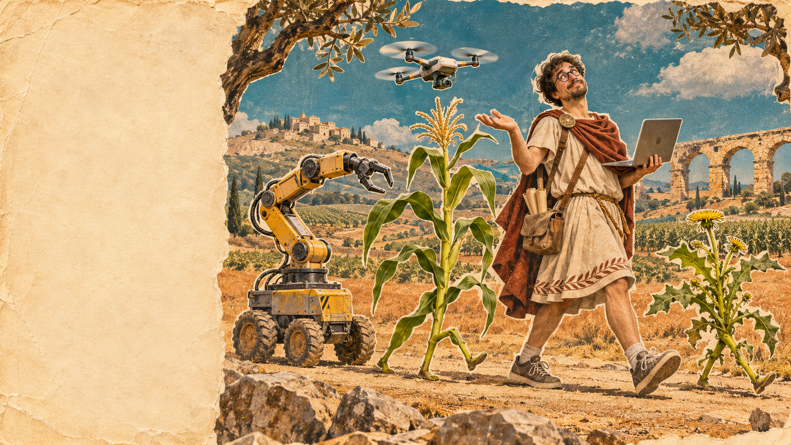

Christian Rueda-Ayala · MEDAILAB / UMU
<h1>Life of <del>Brian</del> <em>Chris</em></h1>
Robótica, IA y Agricultura Digital

Life of Chris01 / 20

<!--
Soy Christian. Para contaros cómo he llegado hasta aquí, he tomado prestado el título de una película. Lo que viene es una versión bastante más corta, con robots, redes neuronales y unas cuantas malas hierbas. Mi recorrido ha pasado por varios ámbitos, pero hay herramientas y preguntas que los conectan. [PAUSA] La imagen es una ilustración conceptual generada, no una fotografía mía.

Fuente: Conversación del ponente; ilustración generada y prompt en assets.
Tiempo previsto: 20 s.
-->
