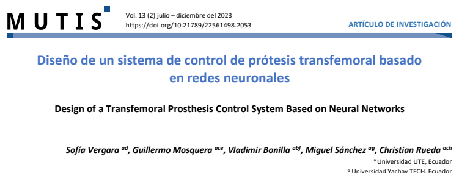

<header class="story-head">
COAUTORÍA · ROBÓTICA MÉDICA
<h1>Ver es una cosa. <em>Controlar, otra.</em></h1></header><figure class="clipping main-paper" tabindex="0" role="button" aria-label="Ampliar recorte: Mutis · 2023 · artículo de investigación"><figcaption>Mutis · 2023 · artículo de investigación</figcaption></figure>

Prótesis transfemorales
<h2>Diseño + control neuronal + comparación</h2>También: contribuciones en CICI 2023 y AENIT 2024.

Robótica médica06 / 20

<!--
Una parte de mi trabajo ha estado relacionada con prótesis transfemorales: diseño mecánico, control con redes neuronales y comparación de controladores. Estas contribuciones aparecen en Mutis, CICI y AENIT. Me interesa esa conexión entre el sistema físico, las señales y el algoritmo que gobierna el movimiento. También hubo un brazo robótico asistencial. El recorte es de la primera página del artículo de Mutis de 2023, con la autoría original. No implica validación clínica.

Fuente: CV, p. 28: Mutis 2023; CICI 2023; AENIT 2024. Ilustración generada. Recorte original del PDF Mutis localizado en Downloads; procedencia en sources/recortes-v2.json.
Tiempo previsto: 35 s.
-->
