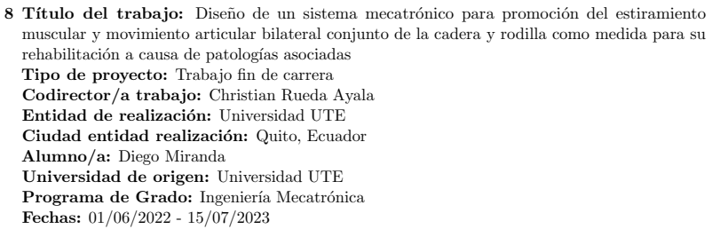
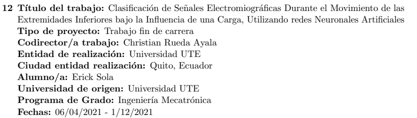
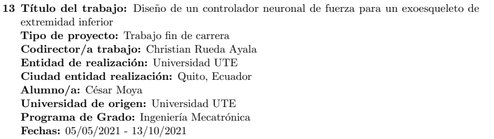
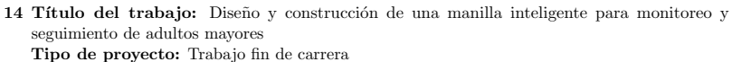

<header class="story-head">
CODIRECCIÓN · UTE · ECUADOR
<h1>De las señales <em>a la asistencia.</em></h1></header>
<figure class="clipping " tabindex="0" role="button" aria-label="Ampliar recorte: Diego Miranda · rehabilitación · 2022–2023"><h3>Rehabilitación de cadera y rodilla</h3><figcaption>Diego Miranda · rehabilitación · 2022–2023</figcaption></figure><figure class="clipping " tabindex="0" role="button" aria-label="Ampliar recorte: Erick Sola · señales EMG · 2021"><h3>Clasificación de señales EMG</h3><figcaption>Erick Sola · señales EMG · 2021</figcaption></figure><figure class="clipping " tabindex="0" role="button" aria-label="Ampliar recorte: César Moya · exoesqueleto · 2021"><h3>Control neuronal de un exoesqueleto</h3><figcaption>César Moya · exoesqueleto · 2021</figcaption></figure><figure class="clipping " tabindex="0" role="button" aria-label="Ampliar recorte: Joseline Naranjo · monitoreo · 2021"><h3>Monitoreo de adultos mayores</h3><figcaption>Joseline Naranjo · monitoreo · 2021</figcaption></figure>

Recortes del CV · trabajos de fin de carrera · pp. 23–25

Trabajos dirigidos / UTE07 / 20

<!--
En trabajos que dirigí o codirigí, esta relación se extendió a rehabilitación de cadera y rodilla, clasificación de señales electromiográficas durante movimiento bajo carga, un controlador neuronal de fuerza para un exoesqueleto y una manilla para monitorear adultos mayores. Son aportaciones de estudiantes con los que trabajé: Diego Miranda, Erick Sola, César Moya y Joseline Naranjo, respectivamente. Aquí mi papel fue de supervisión; no presento todos estos trabajos como desarrollos individuales míos.

Fuente: CV, pp. 23–25. Diego Miranda 2022–2023; Erick Sola, César Moya y Joseline Naranjo 2021.
Tiempo previsto: 35 s.
-->
