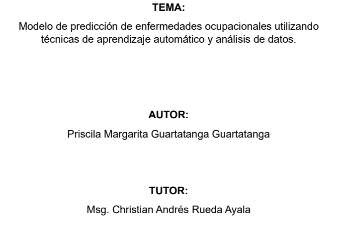
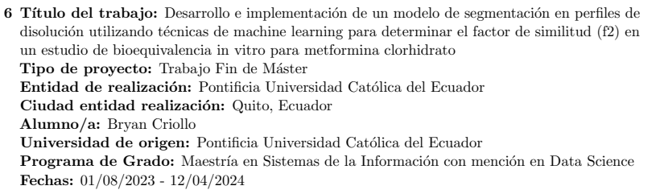
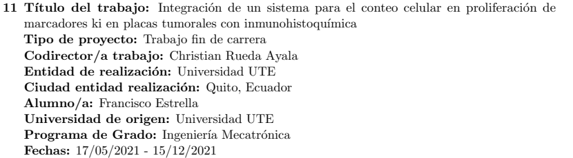

<header class="story-head">
DIRECCIÓN DE TRABAJOS · UTE + PUCE · ECUADOR
<h1>Y de las señales <em>a los datos de salud.</em></h1></header>
<figure class="clipping priscila" tabindex="0" role="button" aria-label="Ampliar recorte: Priscila Guartatanga · TFM PUCE · 2024"><h3>Enfermedades ocupacionales</h3><figcaption>Priscila Guartatanga · TFM PUCE · 2024</figcaption></figure><figure class="clipping bryan" tabindex="0" role="button" aria-label="Ampliar recorte: Bryan Criollo · bioequivalencia · TFM PUCE"><h3>Bioequivalencia de metformina</h3><figcaption>Bryan Criollo · bioequivalencia · TFM PUCE</figcaption></figure><figure class="clipping cells" tabindex="0" role="button" aria-label="Ampliar recorte: Francisco Estrella · conteo celular · UTE"><h3>Conteo celular en placas tumorales</h3><figcaption>Francisco Estrella · conteo celular · UTE</figcaption></figure>

Izquierda: memoria original · derecha: entradas del CV, pp. 23–24

IA aplicada a salud08 / 20

<!--
Otros trabajos abordaron el conteo celular en placas tumorales con inmunohistoquímica, con Francisco Estrella; y dos TFM de Data Science de PUCE. Priscila Guartatanga trabajó en predicción de enfermedades ocupacionales. Bryan Criollo utilizó machine learning para segmentar perfiles de disolución y estudiar el factor de similitud f2 en bioequivalencia in vitro de metformina. Son aplicaciones diferentes, con una base compartida de tratamiento de datos y modelado. Sus títulos no implican resultados clínicos demostrados.

Fuente: CV, pp. 22–24. Francisco Estrella 2021; Priscila Guartatanga y Bryan Criollo 2023–2024. Portada original Trabajo_Titulación_GUARTATANGA_PRISCILA.pdf, p. 1.
Tiempo previsto: 35 s.
-->
