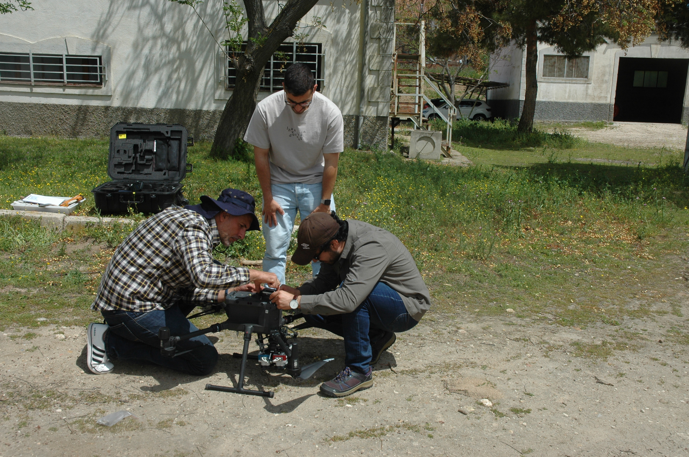
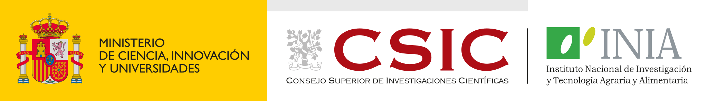

VISIÓN + SENSORES + IA → AGRICULTURA DIGITAL
<h1>No era un giro <em>tan inesperado.</em></h1>

INIA–CSIC · desde 2024<small>España</small>

Agricultura digital09 / 20

<!--
La agricultura ya estaba en mi trabajo de grado y en mi máster, y volvió a aparecer en NIBIO. Los proyectos de salud ampliaron mi experiencia con señales, modelos y sistemas físicos. En INIA-CSIC, desde 2024, esas herramientas vuelven a reunirse alrededor de un problema agrícola. Por eso no lo veo como un salto desconectado. Hoy la agricultura digital es el centro de mi actividad. La foto es de preparación de un dron en equipo, sin atribución a una campaña concreta.

Fuente: CV y base factual; fotografía aportada src/DSC_0047_1.JPG.
Tiempo previsto: 20 s.
-->
