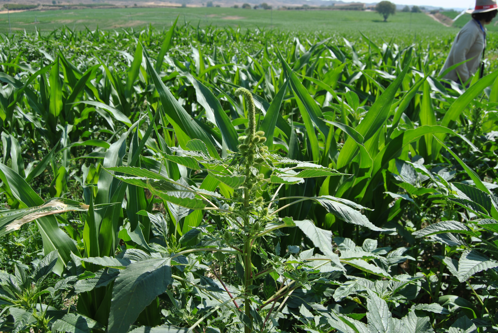

MALAS HIERBAS INVASORAS
<h1>¿Qué planta es? <em>¿Dónde está?</em></h1>

El problema10 / 20

<!--
En malas hierbas invasoras, la identificación y la localización importan. Mi trabajo actual se centra en Amaranthus palmeri y su diferenciación respecto de especies próximas, conectando observaciones, imágenes y cartografía. La pregunta que organiza los proyectos es cómo obtener información útil y fiable para apoyar la vigilancia y el manejo. Esta foto contextualiza el problema en cultivo; no se utiliza como identificación taxonómica documentada.

Fuente: DIGITALWEEDS, memoria 2025, objetivos; foto src/DSC_0047.JPG.
Tiempo previsto: 25 s.
-->
