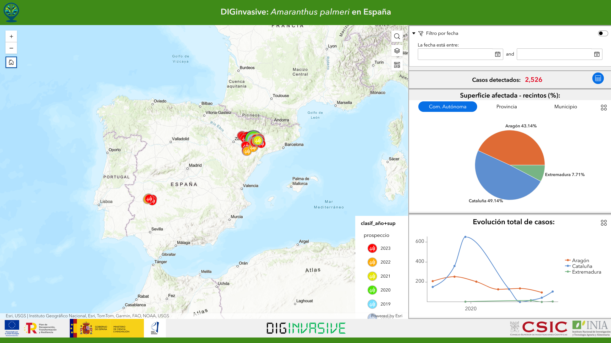

DIGinvasive · OBSERVACIONES → INFORMACIÓN
<h1>Primero, <em>reunir lo que ya sabemos.</em></h1>

DIGinvasive · captura de referencia del visor público

Mi aportación: datos, código e integración del visor.

DIGinvasive11 / 20

<!--
DIGinvasive es una plataforma geoespacial para consultar y analizar detecciones confirmadas de Amaranthus palmeri. Mi aportación técnica incluyó código, procesos ETL, integración web y despliegue. La responsabilidad científica corresponde al proyecto liderado por Ana de Castro. En 2026 he trabajado también en documentación para transferencia y en el manuscrito. Esta es una captura histórica del visor público, recortada al mapa; no presenta cifras vigentes ni demuestra cobertura nacional exhaustiva.

Fuente: Dossier DIGinvasive; src externo diginvasive_doc/imgs/Visor público.png; Obsidian, documentación OTRI y manuscrito 2026.
Tiempo previsto: 40 s.
-->
