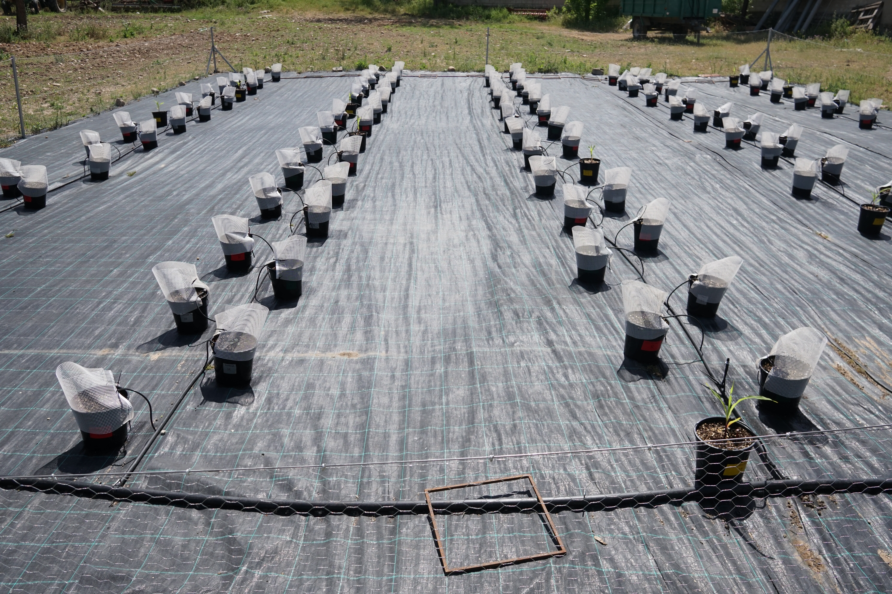

INIA–CSIC · ESPAÑA · MOMENTUM
<h1>DIGITAL <em>WEEDS</em></h1>
De las observaciones a nuevas herramientas de detección de malas hierbas invasoras.

Momentum12 / 20

<!--
Mi proyecto actual, DIGITALWEEDS, forma parte del programa Momentum. Su nombre completo es Nuevas herramientas digitales para el control eficiente de malas hierbas invasoras. Combina drones, sensores, inteligencia artificial y herramientas geoespaciales para identificar, caracterizar y cartografiar Amaranthus palmeri. El objetivo es aportar herramientas que ayuden al manejo, y no asumir que el problema queda resuelto por disponer de una imagen.

Fuente: Memoria DIGITALWEEDS 2025, pp. PDF 1 y 12–13; foto src/DSC04890.JPG.
Tiempo previsto: 30 s.
-->
