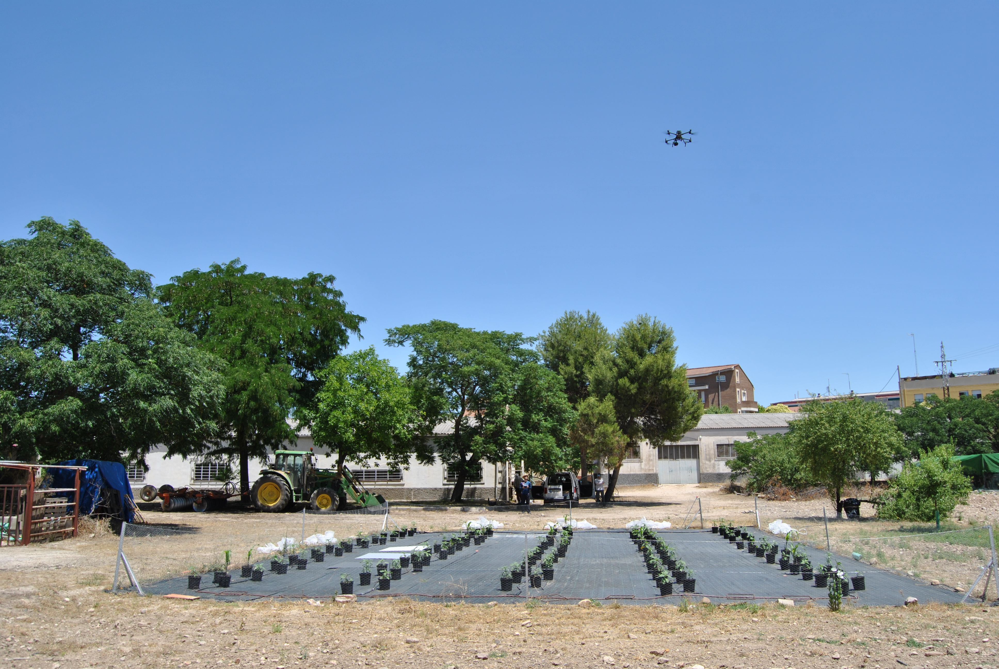

TRABAJO REALIZADO · CAMPAÑAS Y REFERENCIAS
<h1>La IA empieza <em>mucho antes del modelo.</em></h1>

2026 · Alguaire · Vilasaña · Albelda Vuelos, referencias de campo y normalización fenológica

Trabajo realizado14 / 20

<!--
Una parte importante del trabajo ha sido construir la base experimental: ensayos, vuelos, sensores y referencias de campo. En 2026 constan vuelos en Cataluña, en Alguaire y Vilasaña, y una campaña en Albelda con el CITA de Aragón. A ello se suman la normalización fenológica y el análisis de los datos. La fotografía es aportada por mí como contexto de adquisición; no afirmo que corresponda a esas campañas concretas.

Fuente: Obsidian: detalle junio–septiembre 2026 y campaña CITA Albelda. Foto src/DSC_0147.JPG.
Tiempo previsto: 30 s.
-->
