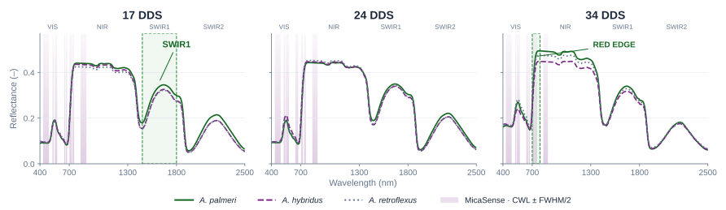
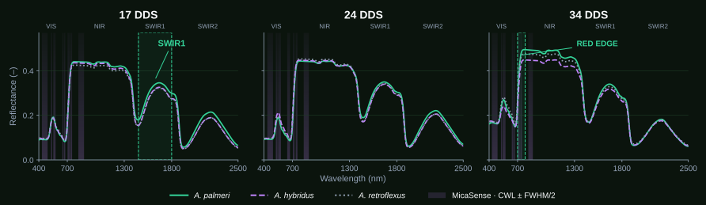

TRABAJO PRESENTADO EN SEMH2026
<h1>Para distinguirlas, <em>¿qué señal necesitamos?</em></h1>

Información foliar · base para el desarrollo posterior en imágenes

Información espectral16 / 20

<!--
En SEMH2026 presenté el trabajo sobre información espectral para distinguir Amaranthus palmeri, hybridus y retroflexus. La idea que quiero destacar aquí es que importa qué información medimos y en qué momento observamos. Los resultados foliares orientan la investigación posterior en imágenes. No son por sí solos la validación de un detector de campo: la separabilidad espectral y la exactitud de clasificación son cosas diferentes.

Fuente: SEMH2026: contenido y guion oral; figura firmas-light/dark.svg de la presentación original. No confundir campaña 2026 con datos del ensayo presentado.
Tiempo previsto: 35 s.
-->
