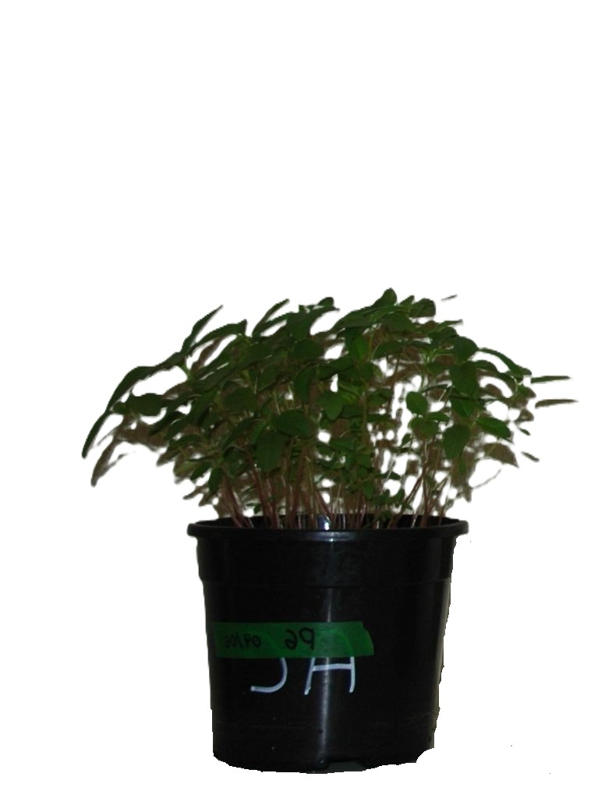
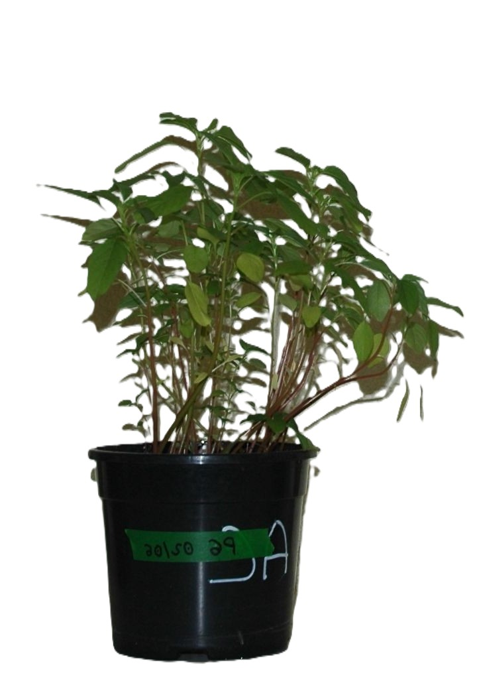
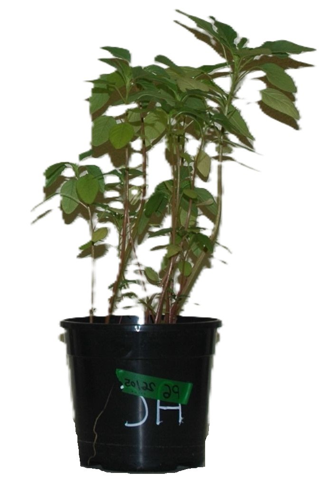

DIGITALWEEDS · ELEGIR INFORMACIÓN PARA DETECTAR
<h1>Antes de entrenar la IA, <em>elegir qué observar.</em></h1>

<figure><figcaption>17 DDS</figcaption></figure><figure><figcaption>24 DDS</figcaption></figure><figure><figcaption>34 DDS</figcaption></figure>

<button class="signal-reveal" type="button">Ver las firmas ↓</button>

Firmas foliares → bandas y momentos de observación → futuros modelos de detección

Información espectral16 / 20

<!--
En SEMH2026 presenté el trabajo sobre información espectral para distinguir Amaranthus palmeri, hybridus y retroflexus. La idea que quiero destacar aquí es que importa qué información medimos y en qué momento observamos. Los resultados foliares orientan la investigación posterior en imágenes. No son por sí solos la validación de un detector de campo: la separabilidad espectral y la exactitud de clasificación son cosas diferentes. Su vínculo con DIGITALWEEDS es orientar qué información espectral y qué momentos de observación pueden ser útiles para diferenciar especies. Es una base experimental para la detección posterior, no un detector de campo ya validado. Animación original SEMH: mostrar las fotografías de 17, 24 y 34 DDS; al primer avance se reducen y aparecen las firmas alineadas debajo. El siguiente avance pasa de diapositiva. DDS = días después de la siembra. Las fotografías son del ensayo original.

Fuente: SEMH2026: contenido y guion oral; figura firmas-light/dark.svg de la presentación original. No confundir campaña 2026 con datos del ensayo presentado. Fotos y secuencia recuperadas de SEMH2026, slide 06, assets/results/dds_17.jpg, dds_24.jpg y dds_34.jpg.
Tiempo previsto: 35 s.
-->
