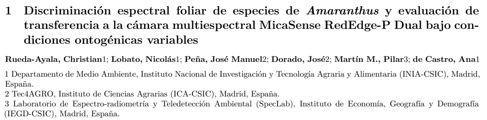

<header class="story-head">
SEMH2026 · TRABAJO EN EQUIPO
<h1>Y esto nos dio <em>una alegría.</em></h1></header><figure class="clipping award-clipping" tabindex="0" role="button" aria-label="Ampliar recorte: Recorte del manuscrito presentado · Rueda-Ayala y equipo"><figcaption>Recorte del manuscrito presentado · Rueda-Ayala y equipo</figcaption></figure>
SEMH 2026<h2>Premio al mejor trabajo presentado</h2>

SEMH202617 / 20

<!--
Este año presenté ese trabajo en SEMH2026 y recibí el premio al mejor trabajo presentado. Fue una alegría y una buena ocasión para compartir la investigación con la comunidad de malherbología. Lo menciono también como reconocimiento a un trabajo de equipo. La denominación utilizada aquí es la que he confirmado en esta conversación; el diploma y el nombre oficial completo quedan pendientes de incorporar. Es distinto del premio al mejor póster de EWRS 2025.

Fuente: Confirmación expresa del ponente en la conversación. Sin imagen de diploma disponible.
Tiempo previsto: 20 s.
-->
