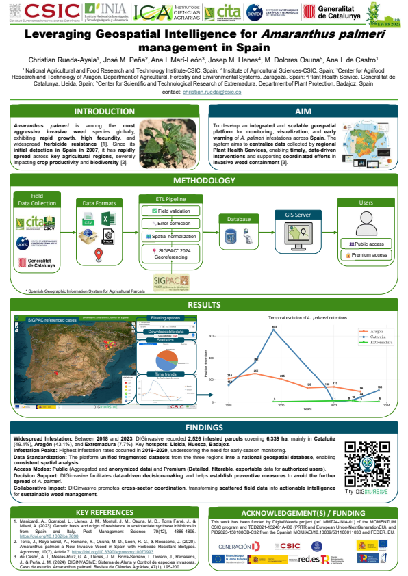
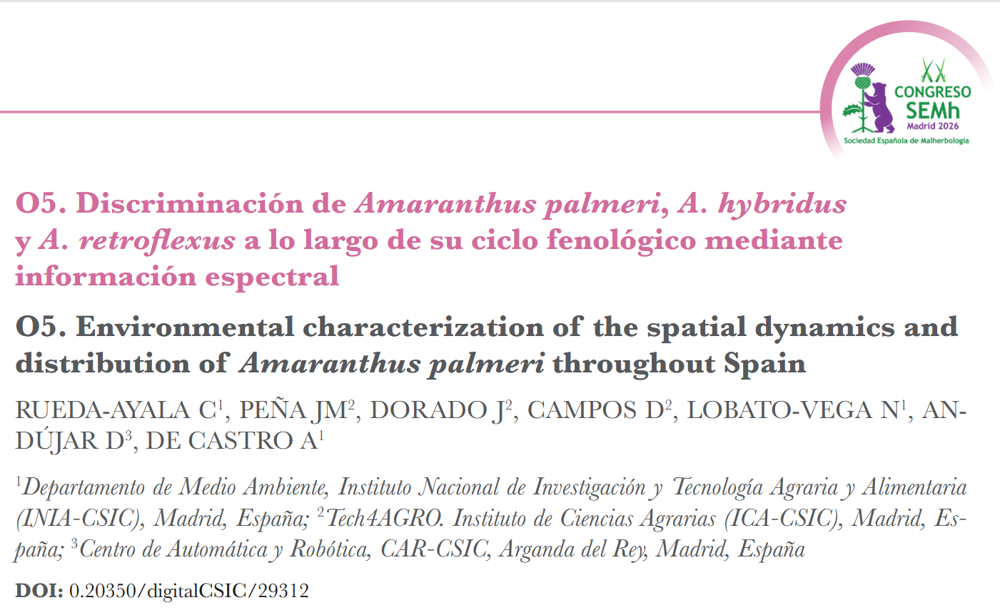

<header class="story-head">
RECONOCIMIENTOS · DOS TRABAJOS EN EQUIPO
<h1>Del mapa a la señal: <em>dos alegrías.</em></h1></header>
<figure class="clipping" tabindex="0" role="button"><h3>EWRS 2025 · mejor póster</h3><figcaption>DIGinvasive · inteligencia geoespacial</figcaption></figure><figure class="clipping" tabindex="0" role="button"><h3>SEMH2026 · mejor trabajo</h3><figcaption>Discriminación de especies mediante información espectral</figcaption></figure>

SEMH202617 / 20

<!--
En EWRS 2025 recibí el premio al mejor póster por el trabajo de inteligencia geoespacial para el manejo de Amaranthus palmeri en España. El boletín SEMh documenta el premio y aquí se muestra el póster. En SEMH2026 recibí el premio al mejor trabajo presentado, según mi confirmación, y se muestra el recorte que he aportado. Son trabajos de equipo. El recorte SEMH contiene una discrepancia entre el título español y el inglés; se conserva sin alterar y se usa el título español confirmado por el ponente.

Fuente: Evidencias Momentum 094_PREM_EWRS_2025.pdf y 096_POST_EWRS_2025.pdf; assets/articulo_semh2026.png aportado por el usuario. Premio SEMH confirmado en conversación.
Tiempo previsto: 20 s.
-->
