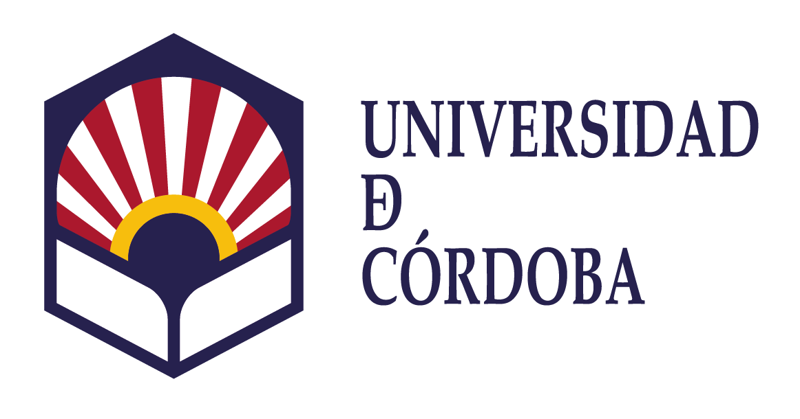
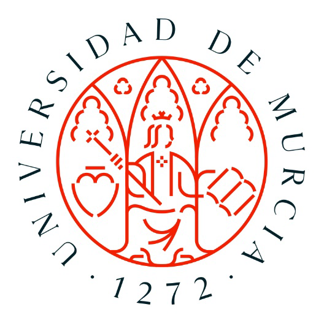

<header class="story-head">
FORMACIÓN EN CURSO · ESPAÑA
<h1>Y sigo <em>siendo estudiante.</em></h1></header>

Universidad de Córdoba<small>España</small>
<h2>Doctorado</h2>
Ingeniería Agraria, Alimentaria, Forestal y Desarrollo Rural Sostenible.
<strong>Desde 2024 · en curso</strong>

Universidad de Murcia<small>España</small>
<h2>Máster en IA</h2>
ML · DL Visión por computador · XAI
<strong>TFM en desarrollo</strong>

La agricultura plantea el problema; la formación ayuda a abordarlo.

Formación actual18 / 20

<!--
La formación no terminó con el máster de robótica. Desde 2024 curso el doctorado en Ingeniería Agraria, Alimentaria, Forestal y Desarrollo Rural Sostenible de la Universidad de Córdoba. También estoy cursando el Máster en Inteligencia Artificial de Murcia, con el TFM en desarrollo. Esta combinación me permite trabajar el problema agronómico y las herramientas de IA de forma conectada. Es precisamente lo que da sentido a estar ahora aquí, en MEDAILAB. Ninguno de estos títulos se presenta como finalizado.

Fuente: Base factual del CV, revisión v3 10/08/2026, formación; Obsidian reunión TFM 04/11/2026. Logos recortados de documentos académicos originales.
Tiempo previsto: 25 s.
-->
