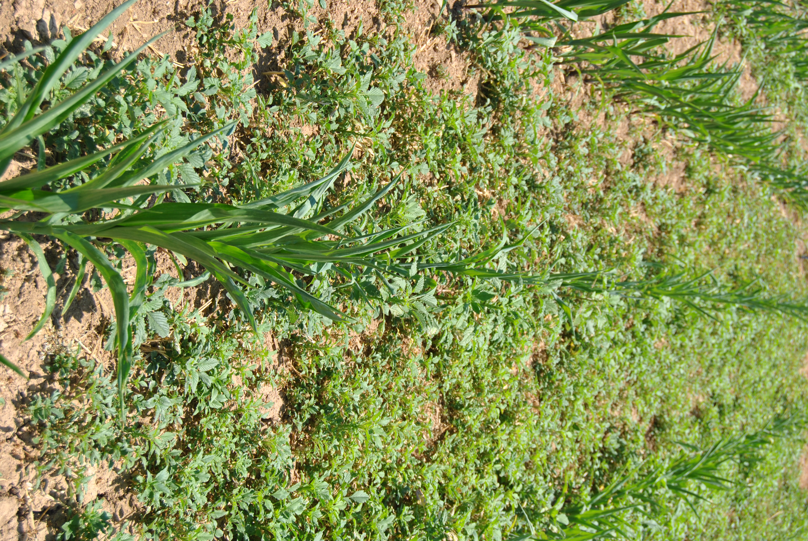

LIFE OF CHRIS
<h1>Continuará… <em>en el campo.</em></h1>
Robótica · IA · Agricultura Digital

Christian Rueda-Ayala christian.rueda@csic.es

Life of Chris20 / 20

<!--
Ese es el hilo que me trae hasta aquí: sistemas que perciben, datos que podemos interpretar y herramientas que intentan resolver problemas reales. Ahora, principalmente, en agricultura digital. Me apetecía compartirlo con vosotros y conocer vuestras ideas para esta etapa. Gracias. [PAUSA Y CIERRE]

Fuente: Síntesis del ponente; contacto de SEMH2026; foto src/DSC_0173.JPG.
Tiempo previsto: 15 s.
-->
